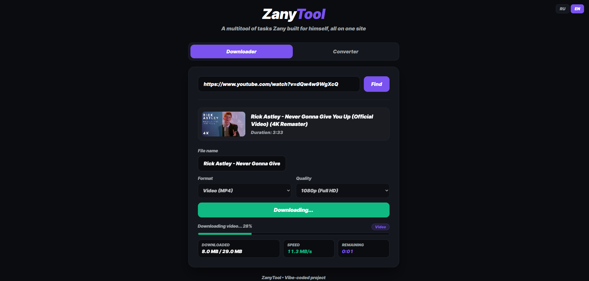
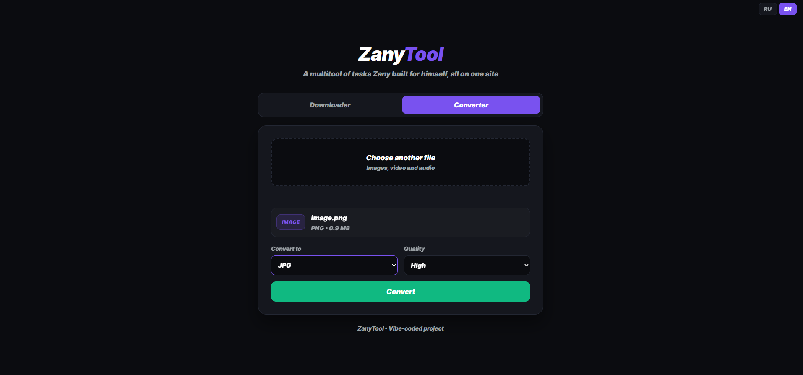

<h1 align="center">ZanyTool</h1>

<p align="center">
  A multitool of tasks I built for myself, all on one site.<br>
  YouTube downloader + file converter. Runs locally, no ads, no sign-up, totally free.
</p>

<p align="center">
  
  
</p>

## Features

- **Downloader**: YouTube to MP4 (up to 1080p) or MP3, with live progress, speed and ETA
- **Converter**: images, video and audio to other formats (MP4, MKV, WEBM, GIF, MP3, FLAC, PNG, WEBP and more)
- **RU / EN** language switch

## How to run (Windows)

**1. Install Python** (version 3.10 or newer). During installation, tick **"Add python.exe to PATH"**.

**2. Install ffmpeg and Deno.** Open PowerShell and run:

```powershell
winget install Gyan.FFmpeg
winget install DenoLand.Deno
```

**3. Restart your terminal** (or VS Code) so it sees the new programs.

**4. Download the project and start it.** In the project folder, run:

```powershell
python -m venv backend\venv
.\backend\venv\Scripts\python.exe -m pip install -r requirements.txt
.\backend\venv\Scripts\python.exe backend/server.py
```

The site opens in your browser automatically.

Next time, you only need the last command.

> If downloads stop working, update yt-dlp:
> `.\backend\venv\Scripts\python.exe -m pip install -U "yt-dlp[default]"`

## About

A personal project, **vibe-coded** with AI (Claude+Gemini). Built with Python, Flask, yt-dlp, ffmpeg and plain HTML / CSS / JS.
